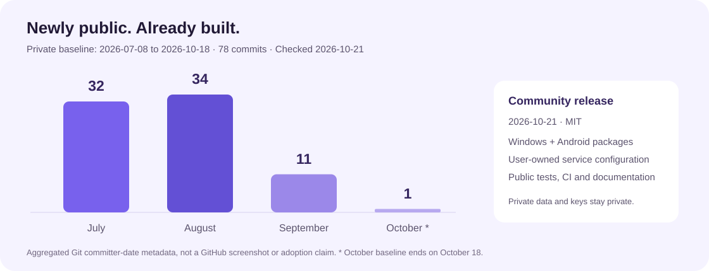

# Development history / 开发历程

**Newly public, not newly developed.** SyncNote Community is a newly published MIT edition of an application developed and used privately before its public release. This page separates that development history from public adoption.

## What the records establish

The maintainer's original local Git history, checked on **2026-10-21**, contains **78 commits reachable from the checked-out private baseline**, dated **2026-07-08 through 2026-10-18**. The checkout is not shallow. Dates below are Git **committer dates**, not a claim of daily activity or a measure of engineering quality.

| Month | Commits in that private baseline |
| --- | ---: |
| July 2026 | 32 |
| August 2026 | 34 |
| September 2026 | 11 |
| October 2026, through October 18 | 1 |
| **Total** | **78** |

These are **maintainer-reported aggregates derived from private Git metadata**, not screenshots of a public GitHub contribution graph. They are not public-repository commits, external contributors, issue counts, downloads or evidence of broad adoption. The private repository and its full history remain private.

## Selected milestones

The following summaries are based on the original commit subjects and describe what was introduced or repaired at the time. A historical commit described as completing a phase is not a guarantee that its features have no remaining limitations.

| Date | Recorded work | Current public source to inspect |
| --- | --- | --- |
| 2026-07-08 | Initial application, cloud synchronization, WebDAV attachments and login fixes | [Shared services](../lib/shared/services/), [auth](../lib/core/providers/auth_provider.dart) |
| 2026-07-09–10 | Task reminders, navigation state, notes/AI workflows, backup reliability and Android capabilities | [Features](../lib/features/), [tests](../test/) |
| 2026-07-17–28 | Cloud file management, memory-based previews, richer document previews and compact lists | [Cloud file screen](../lib/features/cloud_files/), [preview parser](../lib/shared/services/cloud_file_preview_service.dart) |
| 2026-07-30–31 | Exploration workspace and literature PDF/cloud workflows | [Exploration](../lib/features/exploration/) |
| 2026-08-01–02 | Pagination, cold archives, dynamic AI context, semantic puzzle judging, news and literature research | [Cold archives](../lib/shared/services/cold_archive_service.dart), [AI assistant](../lib/shared/services/ai_assistant_service.dart) |
| 2026-08-09–09-01 | Stock research, quantitative data, portfolio risk, shadow monitoring and switchable sources | [Research services](../lib/features/exploration/services/), [Python core](../quant_core/src/) |
| 2026-09-25–27 | Task-specific AI reasoning, a 1000-yuan virtual account, durable journals, read-only agent tools and reports | [Agent service](../lib/features/exploration/services/stock_agent_ai_service.dart), [memory service](../lib/features/exploration/services/stock_agent_memory_service.dart) |
| 2026-10-18 | Windows Firestore cache/login crash correction | [Windows build](../windows/CMakeLists.txt), [startup](../lib/main.dart) |
| 2026-10-21 | Separate MIT community repository, bring-your-own-service setup, independent Android identity/signing, CI and Windows/Android preview releases | [Public history](https://github.com/Dr-xu193/syncnote-community/commits/main/), [Releases](https://github.com/Dr-xu193/syncnote-community/releases), [checks](https://github.com/Dr-xu193/syncnote-community/actions) |

## Why public history starts later

The original application contained personal service configuration and was used with private notes, journals, media and research records. Copying its entire history to a public repository could expose information removed from later files but still present in older commits.

The community edition therefore begins with a sanitized source snapshot and a new history. It asks users to configure their own services, uses a separate Android application identifier and signing key, and documents setup and current limitations. This choice preserves privacy; it does not transfer the original private development history into public contribution metrics.

## What is public now

- MIT source code, build/setup instructions and contribution guidance.
- Windows x64 and Android preview packages in [v0.1.0](https://github.com/Dr-xu193/syncnote-community/releases/tag/v0.1.0).
- Flutter and Python tests plus GitHub Actions checks.
- [Actual application views](PROJECT_SHOWCASE.md), [feature workflows](FEATURES.md), [privacy notes](../PRIVACY.md) and [known limitations](KNOWN_LIMITATIONS.md).

The project is still early in public adoption. No large user base, external contribution volume or package-download statistics are claimed. Future collaboration, community sharing and broader multi-user deployment are plans, not features established by this historical record.
