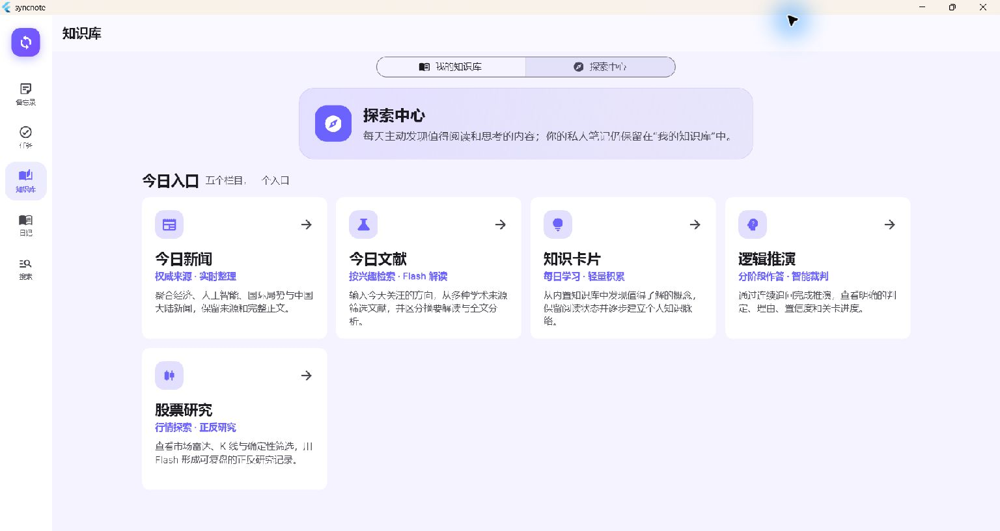
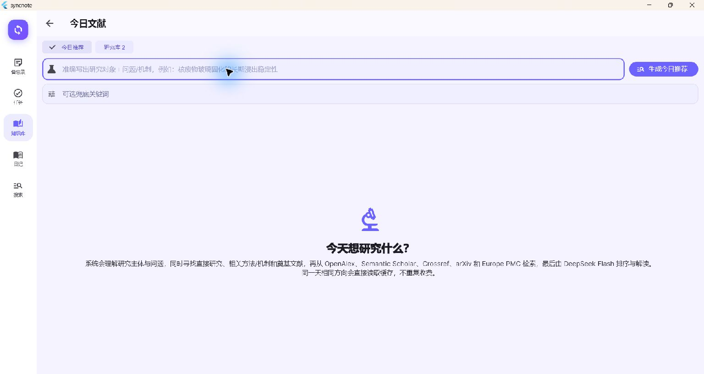
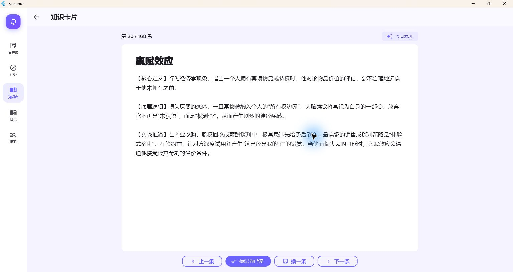
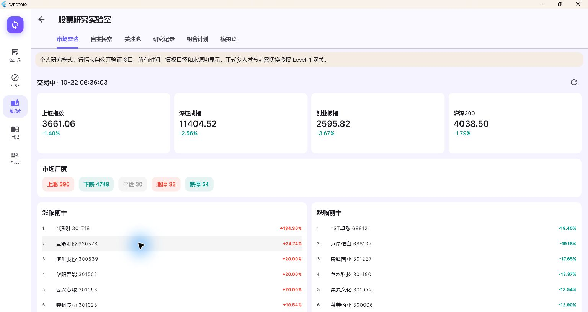
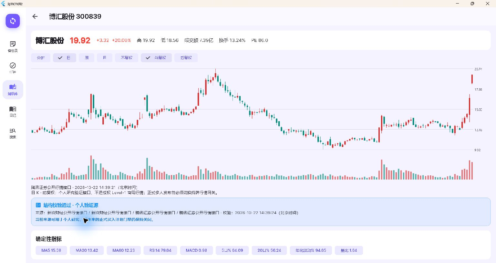

# SyncNote in practice / 实际界面与项目历程

**A personal knowledge workspace with connected AI and research workflows, now opening to community participation.**

[Download Windows / Android](https://github.com/Dr-xu193/syncnote-community/releases/tag/v0.1.0) · [Feature manual](FEATURES.md) · [Setup](SETUP.md) · [Development history](DEVELOPMENT_HISTORY.md) · [Architecture overview](PROJECT_OVERVIEW.md)

## Not just a newly created repository

SyncNote began as a privately developed, daily-use application. Its original Git baseline contains **78 commits dated July 8–October 18, 2026**. The MIT community edition was published separately on October 21 to keep personal data, old credentials and signing keys out of public history. [The timeline and its exact counting scope](DEVELOPMENT_HISTORY.md) distinguish private development from public adoption.

## Actual application views

The screenshots below were captured through Computer Use from the maintainer's already-running **Windows personal edition** on **2026-10-21**. They show shared application workflows, not design mockups or generated AI answers. The Community edition adds its own first-run service configuration and separate app identity; its installation is not the same as an already-configured personal deployment.

Only screens without private note bodies, diary entries, conversations, credentials or account details are included. No private record was modified to stage a screenshot. The gallery does not claim Android visual verification, a new benchmark, perfect retrieval, or universal background reliability.

### One knowledge workspace, several exploration paths

Knowledge exploration lives inside the existing knowledge workspace rather than adding five more primary navigation destinations. A user can move from reading and discovery back into their own notes.

Source: [workspace hub](../lib/features/notes/knowledge_exploration_hub.dart), [notes navigation](../lib/features/notes/notes_screen.dart).

### Research questions, not only a fixed keyword feed

The literature entry accepts a research question and optional fallback keywords. Its underlying workflow combines public academic sources, relevance assessment, clearly separated abstract/full-PDF interpretation, a saved research library, excerpts and links into Markdown notes. This screenshot shows the entry, **not a completed search result or proof of matching accuracy**.

Source: [discovery service](../lib/features/exploration/services/literature_discovery_service.dart), [literature screen](../lib/features/exploration/screens/literature_exploration_screen.dart), [library service](../lib/features/exploration/services/literature_library_service.dart).

### Built-in concepts with readable explanations

The bundled knowledge collection currently contains **168 entries**. The card separates a definition, its reasoning and an example, with navigation and an optional read-state action. The displayed content comes from the bundled collection; no personal annotation or private AI conversation is shown.

Source: [knowledge reader](../lib/features/exploration/screens/knowledge_cards_screen.dart), [bundled datasets](../assets/).

### Market context with explicit research boundaries

The market radar provides index quotes, breadth and gain/loss tables with a displayed observation time. Public quotes are external snapshots, not guaranteed real-time licensed data or recommendations to buy the displayed stocks. The screenshot does not expose a personal portfolio or experiment account.

Source: [market gateway](../lib/features/exploration/services/stock_market_gateway.dart), [research screen](../lib/features/exploration/screens/stock_research_screen.dart).

The detail screen combines candlesticks, volume, period/adjustment choices and deterministic indicators, keeping the source and quality notice beside the chart. Passing a structural data check is **not** commercial market-data authorization, a forecast, or proof of profitability. This is a public-market example, not a personal holding or a recommendation.

Source: [chart renderer](../lib/features/exploration/widgets/stock_kline_chart.dart), [indicator engine](../lib/features/exploration/services/stock_indicator_engine.dart), [quality checks](../lib/features/exploration/services/stock_data_quality.dart).

## The connected workflows behind the screens

| Workflow | What exists in the current source | Where to inspect |
| --- | --- | --- |
| Capture → organize → act | Memos, media attachments, tasks, reminders, journals, tags and compact lists | [Feature screens](../lib/features/), [shared services](../lib/shared/services/) |
| Notes → connected knowledge | Markdown editing, code highlighting, Wiki-style links, graph, history and conflict handling | [Notes](../lib/features/notes/) |
| Personal material → contextual assistance | Source selection, conversations, memories, selected-text AI, source and usage display | [AI assistant](../lib/shared/services/ai_assistant_service.dart), [selection menu](../lib/shared/widgets/ai_context_menu.dart) |
| Research → saved understanding | Multi-source literature, abstract/full-text distinction, saved interpretations, excerpts and notes | [Exploration services](../lib/features/exploration/services/) |
| AI decision → inspectable virtual execution | Six named read-only research tools, validated target portfolios, a separate Python paper core, daily journals and reports | [Agent](../lib/features/exploration/services/stock_agent_ai_service.dart), [Python bridge](../lib/features/exploration/services/stock_agent_paper_runner.dart), [Python core](../quant_core/src/) |
| Growing data → recoverable storage | Pagination, archives, WebDAV cold storage, ZIP backup/restore and capacity references | [Backup](../lib/shared/services/backup_service.dart), [cold archive](../lib/shared/services/cold_archive_service.dart) |

The stock experiment uses **virtual money only**. The model's tool interface is not an unrestricted shell, file manager or brokerage interface. The Python process bridge executes fixed module commands with JSON input and `runInShell: false`; it is not proof of a fully sandboxed execution environment. See [known limitations](KNOWN_LIMITATIONS.md), including incomplete corporate-action accounting and market-data authorization boundaries.

## Engineering that can be checked

- [MIT license](../LICENSE), [Flutter tests](../test/) and [Python tests](../quant_core/tests/).
- [GitHub Actions checks](https://github.com/Dr-xu193/syncnote-community/actions) for static analysis and both test suites.
- [Public preview release](https://github.com/Dr-xu193/syncnote-community/releases/tag/v0.1.0), configuration example, [build guide](BUILD.md) and [privacy notes](../PRIVACY.md).
- User-supplied service configuration held in platform secure storage, no shared service credentials in public installers, and an independent Community Android identity/signature.

The public project is early in adoption and currently maintained by its creator. Public repository statistics and download counters should be read directly from GitHub; maintainer downloads and validation requests are not evidence of external users.

## Where contributions can help

Near-term work includes easier deployment, retrieval quality, cross-platform reliability, backup validation and contextual-AI cost control. Future work may introduce permission-based multi-user collaboration, opt-in sharing, additional model providers and a contributor community. These are directions, not claims that a hosted multi-user service or plugin marketplace already exists.

Contributors can also help review document parsing, untrusted retrieved content, credential boundaries, cloud authorization, local Python invocation and dependency/release integrity. These are security review areas, not assertions that a specific exploit has been confirmed. See [contributing](../CONTRIBUTING.md) and [private security reporting](../SECURITY.md).
